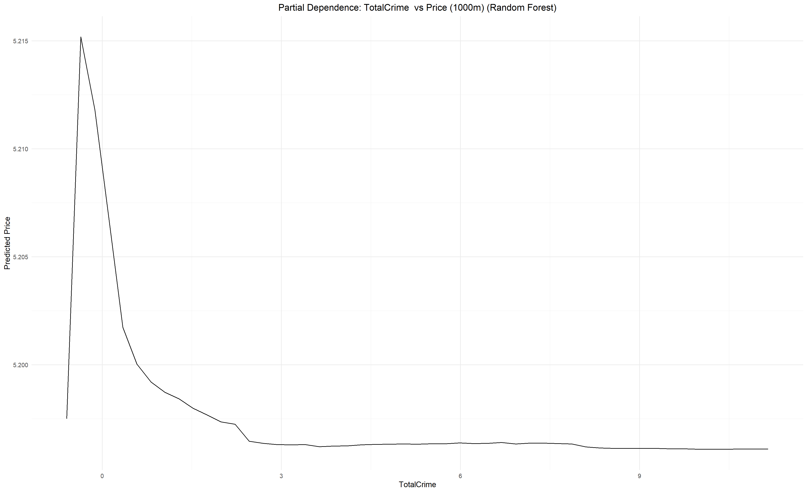
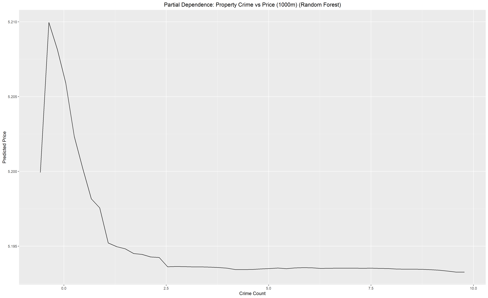
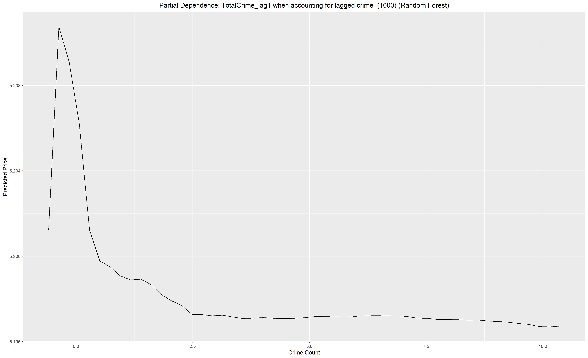

# How Crime Shapes Property Values in Ireland

**MSc Business Analytics thesis · R (tidymodels, sf, spatialreg) · Tableau**

Does crime near a home lower what it sells for in Ireland, and which kinds of crime matter most? I matched **over 650,000 Property Price Register sales** to Garda crime counts within **500 m to 6 km** of each home, added location and economic controls, and compared hedonic, spatial econometric and machine-learning models.



*Random Forest partial dependence: predicted log price falls sharply as recorded crime within 1 km rises from 0 to about 3 incidents, then levels off.*

## Key findings

1. **Crime lowers prices, and the first few incidents matter most.** Predicted prices drop steeply between 0 and about 3 incidents, then flatten. At 1 km the drop is roughly 0.018 in log₁₀ price, about **4% lower** (approximate, read from the plot above).
2. **Property crime hurts prices more than personal-safety crime**, in all six buffer sizes. Burglary, theft and criminal damage outweigh assault and robbery. A linear model suggested the opposite; the non-linear model reversed it.
3. **Violent crime only dominates very close to a home (500 m).** From 1 km out, non-violent crime has the slightly larger effect.
4. **High- and low-value areas react about the same.** In 4 of 6 datasets there was no meaningful difference.
5. **Buyers react to past crime.** Crime two years before the sale had a stronger effect than crime in the year of sale.

| Hypothesis | Supported? | Evidence |
| --- | --- | --- |
| H1 Total crime lowers prices | Yes | 6 of 6 buffers |
| H2 Violent crime lowers prices more than non-violent | No | Only at 500 m |
| H3 Personal-safety crime lowers prices more than property crime | No | Property crime larger in 6 of 6 |
| H4 High-income areas are more resilient | No | No difference in 4 of 6 |
| H5 Crime has immediate and delayed effects | Yes | Two-year lag strongest |

## Model performance (test set, R²)

| Model | 500 m | 1 km | 2 km | 3 km |
| --- | --- | --- | --- | --- |
| Hedonic OLS | 0.59 | 0.62 | 0.62 | 0.63 |
| XGBoost | 0.70 | 0.72 | 0.74 | 0.75 |
| **Random Forest** | **0.71** | **0.73** | **0.75** | **0.76** |

At 6 km, Random Forest reached 0.76 and XGBoost 0.74. OLS residuals showed significant spatial clustering (Moran's I, p < 0.001), so spatial lag, error and Durbin models were also fitted; the spatial lag model gave a small improvement over OLS. Random Forest improved accuracy by about 10% over the traditional models.

## Business use

- **Lenders and insurers:** add local crime trends, especially property crime and two-year history, to valuation and risk models.
- **Developers and investors:** factor crime trends into site selection; even small increases are priced in.
- **Local authorities:** prioritise property-crime reduction where it protects the most housing value.

## Approach (CRISP-DM)

1. **Geocoding and validation** of property and Garda station addresses: see [GEO_coding-](https://github.com/Ayoola-droid/GEO_coding-).
2. **Location features:** distance to the nearest town, train station, airport, hospital (only hospitals open at the sale date) and Garda station; population and housing density; mortgage rate and construction cost index matched to the sale date.
3. **Crime exposure:** crime by type counted within 500, 1000, 1500, 2000, 3000 and 6000 m buffers, for the sale year and one and two years before.
4. **County controls:** income, population and housing stock forecasts: see [irish-county-forecasts](https://github.com/Ayoola-droid/irish-county-forecasts).
5. **Models:** hedonic OLS, GAM, Random Forest and XGBoost (tuned with tidymodels), spatial lag/error/Durbin models, panel models.
6. **Interpretation:** variable importance and partial dependence plots.

| Property vs personal-safety crime (1 km) | Two-year lagged crime (1 km) |
| --- | --- |
|  |  |

## Repository structure

```
R/
├── 00_setup.R                  # libraries; API keys read from .Renviron
├── 01_location_features.R      # distances, density, rates matched to sale date
├── 02_crime_buffers.R          # crime counts in 500 m–6 km buffers, with lags
├── 03_eda_and_lags.R           # profiling, lag joins, train/test split
├── 04_hedonic_models.R         # OLS for H1–H5
├── 05_gam.R                    # generalised additive models
├── 06_random_forest_xgboost.R  # tuning, importance, partial dependence
├── 07_spatial_models.R         # Moran's I, SLM, SEM, SDM, GWR
├── 08_panel_models.R
└── 09_visualisations.R
data/                           # small inputs + 5,000-row sample (see data/README.md)
images/                         # figures from the thesis
```

The scripts come from one research pipeline and run in order. Each reads the previous step's output, so the full run needs the raw data listed in `data/README.md`.

## Limitations

- No structural property data (floor area, rooms, age), which limits explanatory power.
- Crime is recorded at Garda station level, not at the exact incident location or date.
- Results show strong associations; they are not proof of causation.

## Author

Ayoola Fadare · MSc Business Analytics (2025) · [LinkedIn](https://www.linkedin.com/in/your-profile) <!-- replace -->
